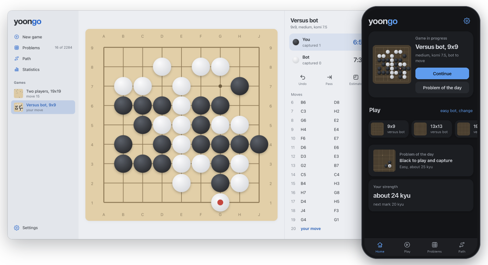
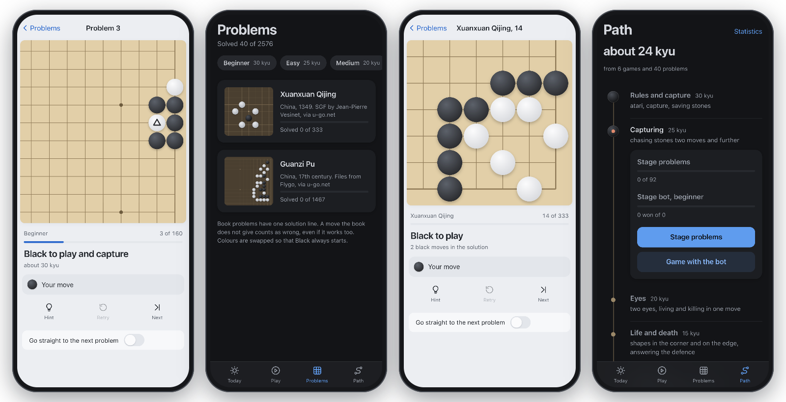

<p align="center"><picture><source media="(prefers-color-scheme: dark)" srcset=".github/logo-dark.png"></picture></p>

<p align="center">Go in the browser.<br>No accounts, no build step.</p>

<p align="center"><a href="https://yoonzky.github.io/yoongo/"><b>Play</b></a>&nbsp;&nbsp;&nbsp;&nbsp;<a href="#problems">Problems</a>&nbsp;&nbsp;&nbsp;&nbsp;<a href="#keyboard">Keyboard</a>&nbsp;&nbsp;&nbsp;&nbsp;<a href="#license">License</a></p>

<p align="center"></p>

## Problems



| Set | Problems | What is inside |
|---|---|---|
| Xuanxuan Qijing | 333 | classic collection, China, 1349 |
| Guanzi Pu | 1467 | classic collection, China, 17th century |
| Beginner | 24 | capture in one move, saving stones in atari |
| Easy | 72 | chasing stones, living and killing in one move |
| Medium | 234 | life and death in the corner and on the edge |
| Hard | 154 | longer life and death lines |

Classic problems follow the solution line from the book. The four levels are generated. Each problem has exactly one correct first move, checked by a life and death solver, and the opponent answers with the most stubborn defence.

## Features

- A short interactive lesson on the rules: liberties, capture, ko, two eyes, counting.
- Play the bot at four levels or a friend on one screen, on 7x7, 9x9, 13x13 and 19x19.
- Territory or capture go: first to take 1, 3 or 5 stones wins.
- Handicap, komi and a clock with byo-yomi.
- Area scoring, positional superko, white gets a point per handicap stone. After two passes the bot marks dead groups, a tap on a group changes that.
- Up to eight unfinished games, undo, a rough estimate of the position, SGF export.
- The last 40 finished games, replayed move by move.
- Hints, and an optional jump to the next problem after a correct solution.
- Path: a rough strength in kyu from 9x9 games against the bot and first tries at problems.
- Light and dark themes, Russian and English.
- On a phone 13x13 and 19x19 open magnified, with a minimap.

## Keyboard

| Action | Keys |
|---|---|
| Move over the board | arrow keys |
| Place a stone | `Enter` or `Space` |
| Undo | `Z` |
| Step through a finished game | left and right arrows |
| Problem: hint, retry, next | `H`, `R`, `N` |

## Structure

```
index.html     markup and script order
css/           tokens, base, app
js/engine/     rules, bot, ld, api, worker
js/app/        i18n, store, ui, board, pages, game, problem, learn, review, main
data/          generated problems, classic collections
icons/         site and app icons
```

The engine has no DOM and runs in a worker. `rules.js` keeps the board with a border and checks superko by Zobrist hash. `bot.js` is Monte Carlo tree search with RAVE and light playouts on a board with pseudo-liberties; the levels differ by the number of playouts. `ld.js` solves life and death on a limited area: Benson's algorithm for unconditional life, iterative deepening, a transposition table.

Games, settings and solved problems are kept in `localStorage`.

## Running locally

```
python3 -m http.server 8000
```

Then open `http://localhost:8000`. Opening `index.html` directly also works; the bot then thinks on the main thread.

## License

Copyright (C) 2026 yoonzky. GNU Affero General Public License v3.0, see [LICENSE](LICENSE).

Anyone who copies or changes the code, including running a changed version as a website, has to keep this notice and share the source under the same license.

The classic collections come from third parties and are not covered by this license, see [THIRD_PARTY_NOTICES](THIRD_PARTY_NOTICES.md).
